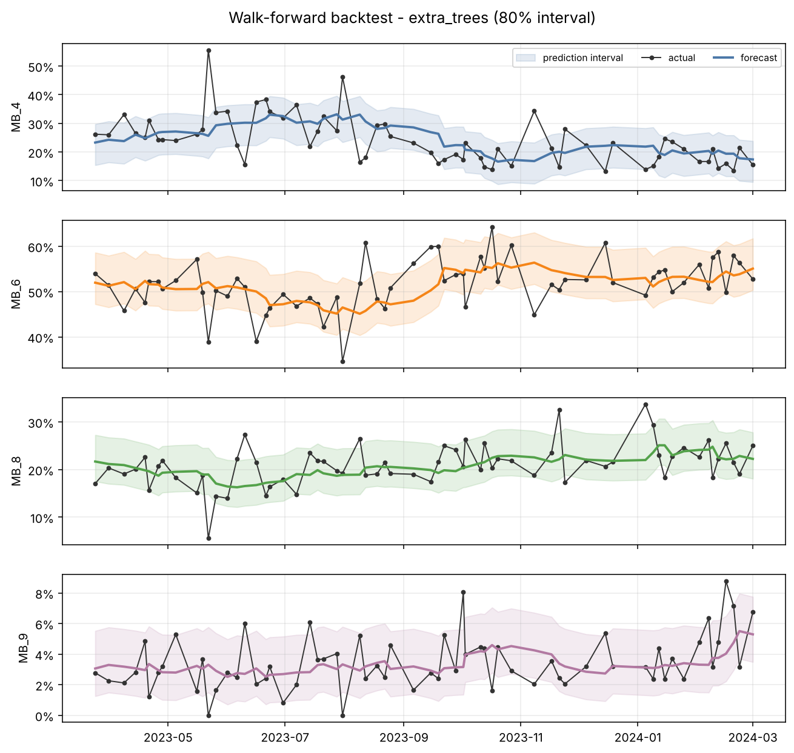
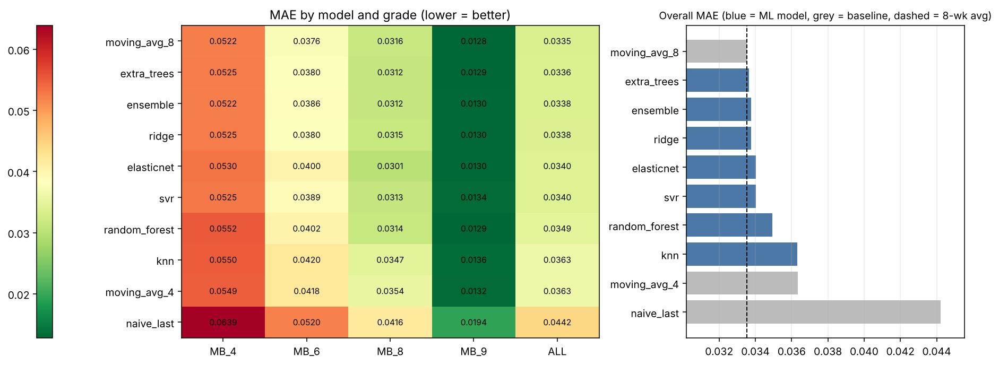
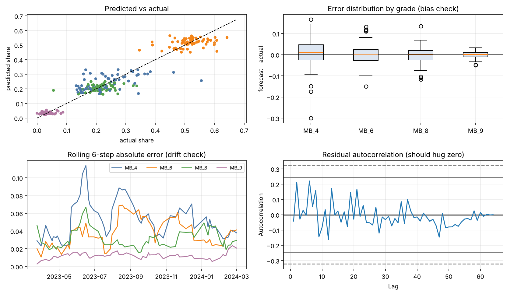
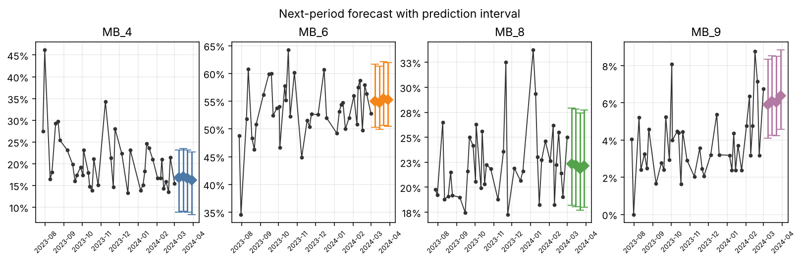

# Marbling-Score Forecasting

Forecast the **share of production in each marbling-score band** (MB_4, MB_6, MB_8, MB_9) for the next date, with a performance dashboard that shows how trustworthy each forecast is.



## Highlights

- **Walk-forward backtest**: every forecast uses only data that existed at that point in time, so the scores are honest.
- **Six models + an ensemble**, tuned once with time-series cross-validation.
- **Optional Google TimesFM 3.0** zero-shot foundation model, forecasting the four grades jointly (one flag to enable).
- **Benchmarked against simple baselines** (naive and moving averages), so you can see whether the models add value.
- **Forecasts are valid shares**: never negative and always totalling 100 %.
- **Prediction intervals** (80 %) taken from backtest errors.
- **Performance matrix**: MAE, RMSE, sMAPE, R² and bias per grade, plus four diagnostic charts.
- Fast: about 28 s end to end on a single CPU core (about 17 s with `--refit-every 4`).

## Quick start

```bash
pip install -r requirements.txt

python run_forecast.py --demo                                    # synthetic data, no files needed
python run_forecast.py --xlsx data.xlsx                          # your data
python run_forecast.py --xlsx data.xlsx --write-excel out.xlsx   # also write forecasts into a COPY of the workbook
python run_forecast.py --xlsx data.xlsx --horizon 4 --refit-every 4
python run_forecast.py --xlsx data.xlsx --timesfm                 # add TimesFM 3.0 (see below) 
```

Input: a sheet with a `Date` column and `MB_4_act%`, `MB_6_act%`, `MB_8_act%`, `MB_9_act%` columns.
Results (CSV tables and PNG charts) are written to `outputs/`.

## Results on the sample plant data

64 walk-forward forecasts (about 15 months):

| Model | MAE | RMSE | R² |
|---|---|---|---|
| moving_avg_8 (baseline) | 0.0335 | 0.0455 | 0.119 |
| **extra_trees** | 0.0336 | 0.0461 | 0.098 |
| ensemble | 0.0338 | 0.0462 | 0.095 |
| ridge | 0.0338 | 0.0459 | 0.104 |
| naive_last (baseline) | 0.0442 | 0.0583 | -0.488 |





**Reading the results.** The models clearly beat a naive "repeat last value" forecast and are on par with an 8-period moving average. Week-to-week grade mix is mostly noise around a slowly drifting level (R² about 0.1), so there is limited extra signal to learn from roughly two years of data. The MB_9 band is hardest in relative terms because its share is small. See [docs/WORKFLOW_AND_METRICS.md](docs/WORKFLOW_AND_METRICS.md) for how to read every metric and chart.

## Optional: TimesFM 3.0 foundation model

[TimesFM 3.0](https://github.com/google-research/timesfm) (Google Research, August 2026) is a 330M-parameter pretrained model that forecasts **without training on your data**. Version 3.0 natively handles several related series together, which suits grade shares that rise and fall against each other. It is added as a candidate next to the other models and scored on the same backtest dates:

| Leaderboard name | What it is |
|---|---|
| `timesfm3` | TimesFM 3.0 forecasting the four grades jointly from the history before each date |
| `ensemble_tfm` | Equal-weight average of the ML ensemble and `timesfm3` |

```bash
pip install -r requirements-timesfm.txt        # Python >= 3.10, downloads PyTorch
python run_forecast.py --xlsx data.xlsx --timesfm                        # CPU
python run_forecast.py --xlsx data.xlsx --timesfm --tfm-device cuda      # GPU
python run_forecast.py --xlsx data.xlsx --timesfm --tfm-univariate       # one grade at a time
```

- **No tuning or refitting**: all backtest origins go through the model in batches, and each forecast only sees data before its date.
- **Native uncertainty band**: TimesFM also returns the 10th-90th percentile; the run prints how often actuals fell inside it (nominal 80 %), a useful check on how well calibrated its bands are.
- **Licence**: the code is Apache-2.0, but the **TimesFM 3.0 pretrained weights are non-commercial and non-production only**. Check that your use complies before using it in a business workflow.
- Results with TimesFM are not included in the tables above; run it on your own data to populate the leaderboard.

## Documentation

[**Workflow and performance-metrics guide**](docs/WORKFLOW_AND_METRICS.md): how the pipeline works step by step, and how to interpret each metric and chart.

